

  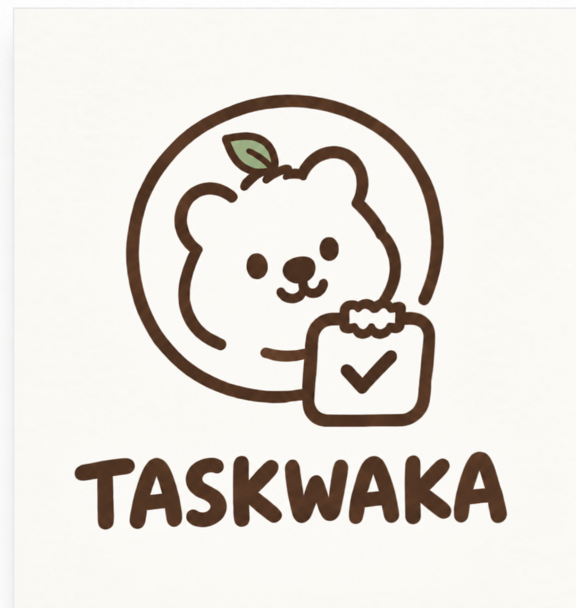

# 🌱 Taskwaka

**팀의 업무 진행과 성장을 함께 기록하는 워크 기반 협업 서비스**

팀원은 워크에 들어와 오늘 할 일과 참여 중인 프로젝트를 확인합니다. 프로젝트 안에서는 업무를 나누고 일일 보고서로 진척도를 기록합니다. 업무 보고서가 승인되면 업무와 프로젝트의 진행률에 반영되고, 팀의 활동은 워크마다 한 그루씩 자라는 성장나무에 쌓입니다.

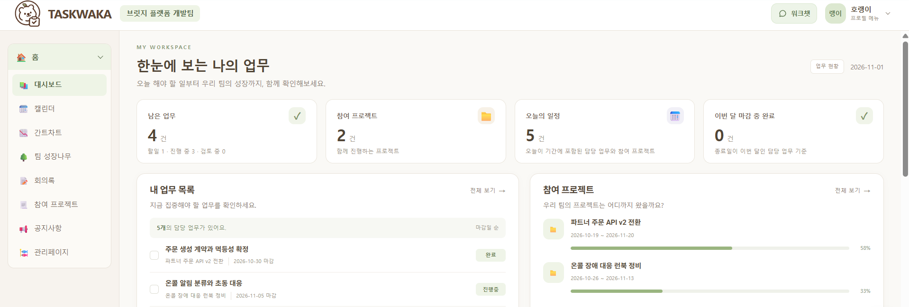

*워크 대시보드에서 내 업무와 참여 프로젝트를 확인하고, 마감이 가까운 항목부터 살펴볼 수 있습니다.*

## 프로젝트 안에서 일하는 방법

| 단계 | 사용자가 할 수 있는 일 |
| --- | --- |
| **1. 워크에 모이기** | 워크를 만들고 팀원을 초대합니다. 팀원은 초대를 수락한 뒤 워크 전용 주소로 접속합니다. |
| **2. 업무 나누기** | 프로젝트에 참여할 인원을 배정하고 업무와 하위 업무의 담당자·기간·상태를 관리합니다. 프로젝트 대시보드에서는 전체 진행률과 마감이 가까운 업무를 확인합니다. |
| **3. 일정 맞추기** | 개인 캘린더에서는 내 일정과 담당 업무를, 프로젝트 캘린더에서는 팀 일정을 확인합니다. 간트 차트에서는 여러 업무의 기간이 겹치는 구간을 볼 수 있습니다. |
| **4. 진행 상황 보고하기** | 일일 보고서에 입력한 진척도는 해당 하위 업무에 반영됩니다. 결재 권한이 있는 사용자는 업무·프로젝트 보고서를 승인하거나 사유를 적어 반려합니다. 업무 보고서 결재 시 승인된 보고서를 기준으로 업무와 프로젝트의 진행률을 다시 계산합니다. |
| **5. 팀 안에서 공유하기** | 공지로 자료와 첨부파일을 공유하고 회의록에 결정 사항을 남깁니다. 워크챗에서는 팀원과 1:1 또는 그룹으로 대화하고 읽지 않은 메시지를 확인합니다. |

## 팀 성장나무

워크를 만들면 팀의 성장나무도 함께 생성됩니다. 초대 수락, 일일 보고서 작성, 보고서 승인 등의 활동으로 경험치를 얻습니다. 성장나무의 최근 활동에서는 **어떤 활동으로 경험치를 얻었는지, 어떤 보상이 회수됐는지** 확인할 수 있습니다.

나무는 **씨앗 → 새싹 → 작은 나무 → 큰 나무 → 왕 나무**의 다섯 단계를 거칩니다. 5단계에 도달하면 워크의 사용 가능 경험치로 배경·열매·모자 등의 아이템을 구매해 팀의 나무에 장착할 수 있습니다.

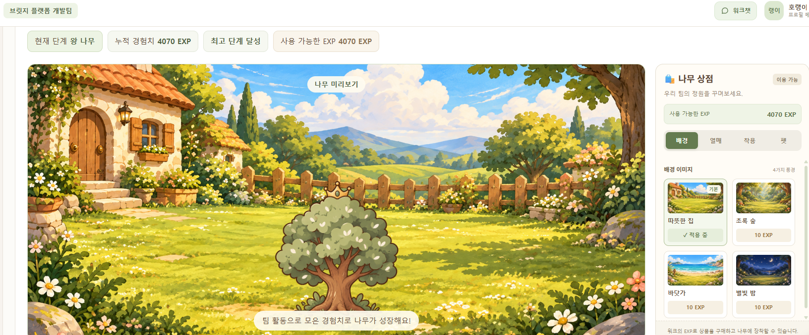

나무의 다섯 단계와 최근 활동 보기

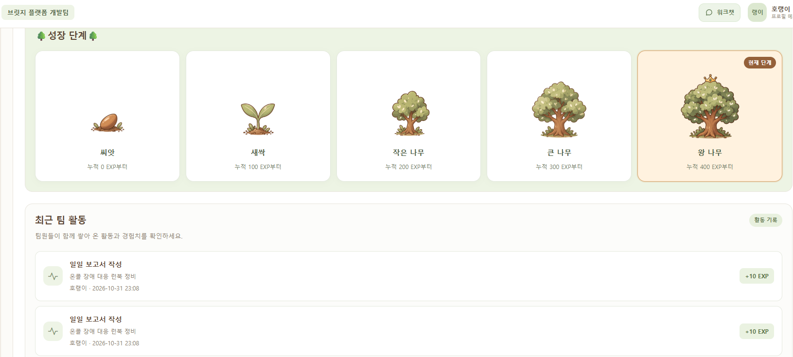

## 역할별 기능

| 역할 | 주요 기능 |
| --- | --- |
| **팀원** | 이메일 인증·카카오 로그인, 내 업무와 일정 확인, 참여 프로젝트 조회, 일일 보고서 작성, 워크챗, 마이페이지에서 프로필·참여 워크 관리 |
| **PM·팀 리더** | 권한 범위에 따른 프로젝트 현황 조회, 인원 배정, 보고서 결재. 관리 대시보드에서는 조회 권한이 있는 프로젝트와 업무에 대해 Gemini에 질문할 수 있습니다. |
| **시스템 관리자** | 회원·워크 상태 관리, PM 변경 요청 처리, 서비스 공지·FAQ 관리, 1:1 문의 답변, 가입·접속·결제 통계 조회 |

## 주요 화면

프로젝트와 업무 · 대시보드, 업무 목록, 간트 차트, 캘린더

**참여 프로젝트 대시보드**에서 전체 진행률과 마감이 임박한 업무를 확인합니다.

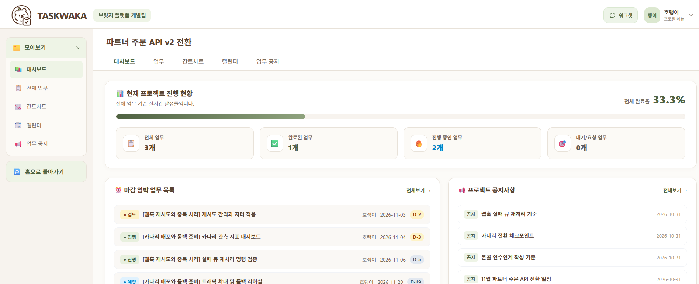

**전체 업무**에서는 업무와 하위 업무의 담당자, 진행률, 기간을 한 목록에서 확인합니다.

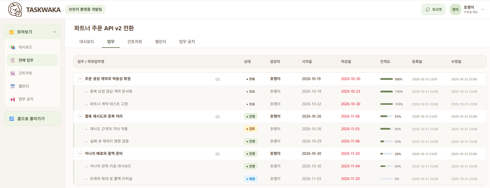

**간트 차트**에서는 시간이 겹치는 업무를, **프로젝트 캘린더**에서는 날짜별 일정을 확인합니다.

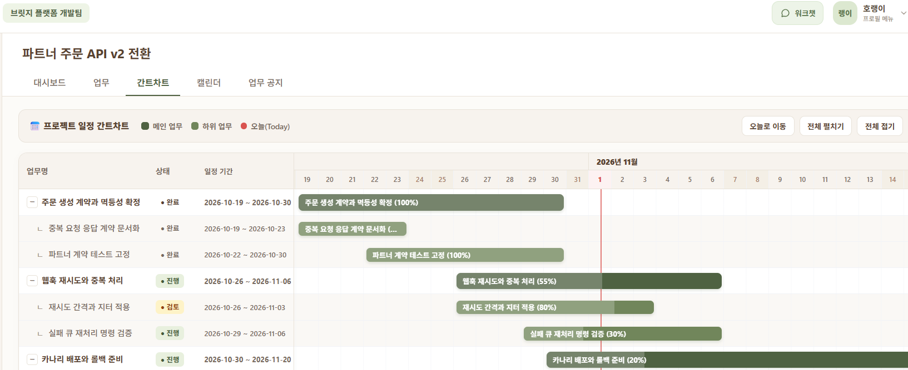

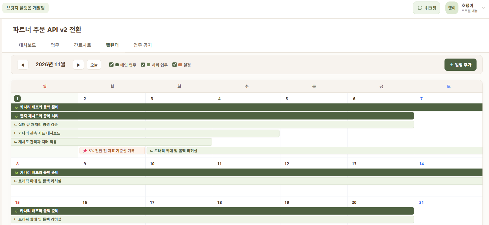

PM 관리와 결재 · 프로젝트 현황, 인원 배정, 보고서 결재

**PM 대시보드**에서 관리 중인 프로젝트 현황을 확인하고, **프로젝트 인원 관리**에서 팀원을 배정합니다.

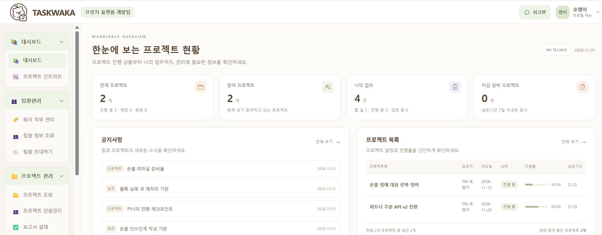

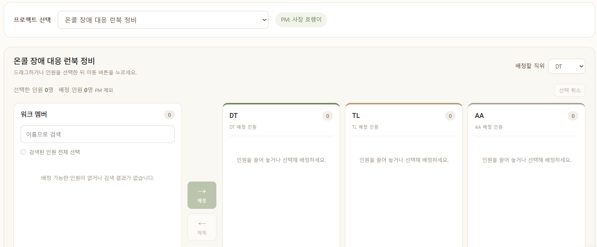

**보고서 결재**에서는 보고서를 유형과 처리 상태로 찾아 상세 내용을 검토합니다.

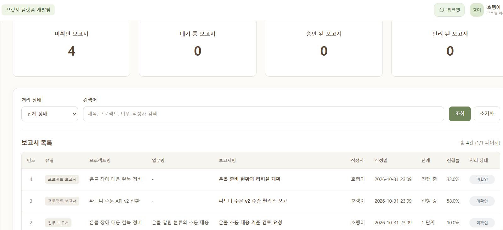

서비스 운영 · 회원과 도메인, 1:1 문의, FAQ, 통계

**시스템 관리자 콘솔**에서는 서비스 전체 회원을 조회하고 도메인별 워크 상태를 확인합니다.

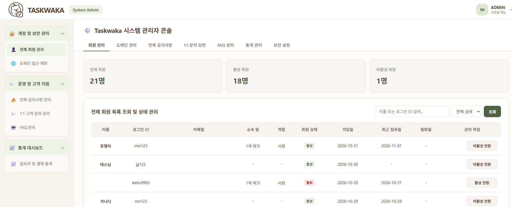

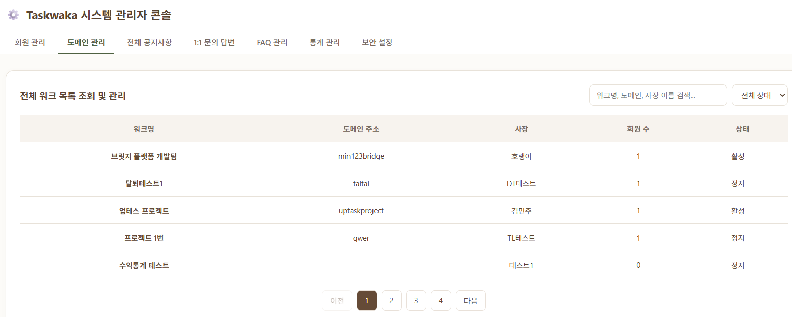

**1:1 문의**에서는 접수된 문의에 답변하고, **FAQ 관리**에서는 자주 묻는 질문과 답변을 편집합니다.

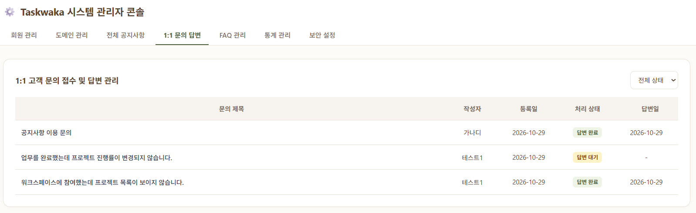

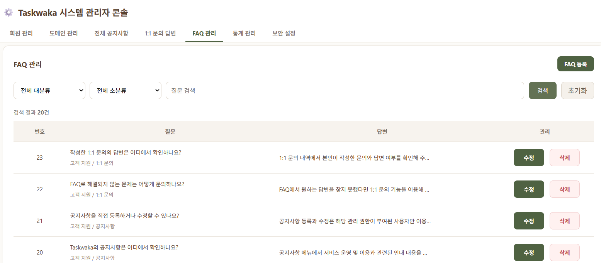

**운영 통계**에서는 결제·환불 금액과 월별 수익 추이를 확인합니다.

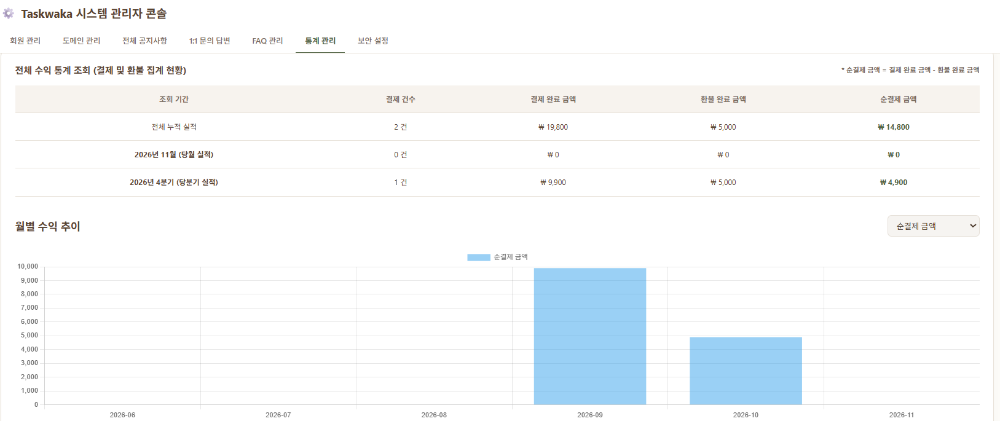

계정 · 로그인과 마이페이지

일반 계정 또는 카카오 계정으로 로그인하고, 마이페이지에서 프로필 사진을 변경할 수 있습니다.

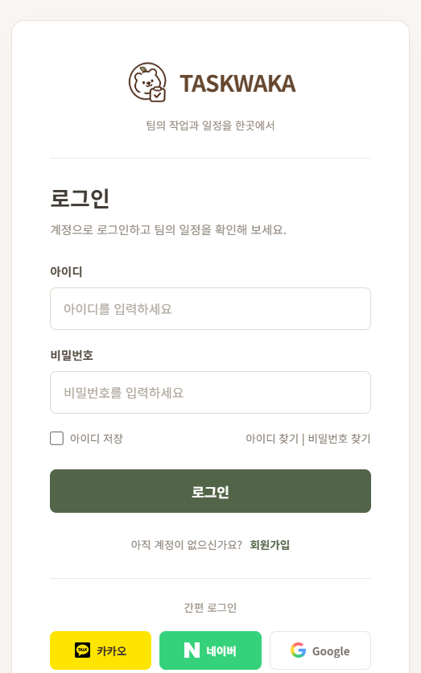

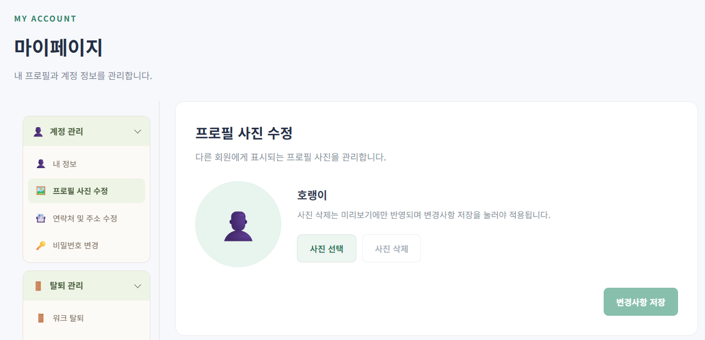

## 기술 스택

| 구분 | 사용 기술 |
| --- | --- |
| 서버 | Java 21, Spring Boot 4.1.1, Spring MVC, Spring Security |
| 화면 | Thymeleaf, HTML/CSS, JavaScript, Bootstrap, FullCalendar, Chart.js |
| 데이터 | Oracle, MyBatis, Spring Data JPA |
| 통신·외부 연동 | WebSocket, STOMP, SockJS, Spring Boot Mail, 카카오 로그인, Gemini API |
| 빌드 | Gradle |
